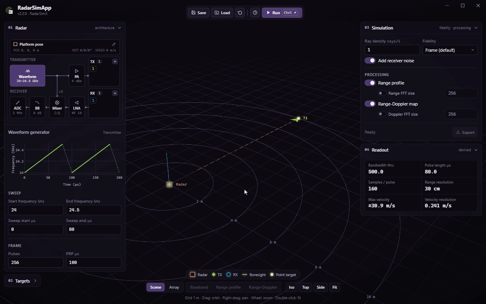

<p align="center">
  
</p>

<h1 align="center">RadarSimApp</h1>

<p align="center">
  A <b>Radar</b> <b>Sim</b>ulation desktop <b>App</b> powered by <a href="https://github.com/radarsimx/radarsimlib">RadarSimLib</a>
</p>

<p align="center">
  <a href="https://github.com/radarsimx/radarsimapp/actions/workflows/test.yml"></a>
  <a href="https://github.com/radarsimx/radarsimapp/releases"></a>
  
</p>

RadarSimApp puts RadarSimLib behind a graphical interface. You lay out an FMCW radar as a block diagram, place point and mesh targets in a live 3D scene, run a baseband simulation, and look at the range profile and Range-Doppler map, all without writing code.

<p align="center">
  
</p>

---

## Highlights

- :satellite: **Radar as a block diagram.** The transmit and receive chains (waveform generator, PA, TX/RX antennas, LNA, mixer, baseband amplifier, ADC) are drawn as blocks. Click a block to edit it; the inspector shows only that block's fields.
- :globe_with_meridians: **Live 3D scene.** The radar, its channels, boresight and targets sit on a ground grid with range rings. Orbit, pan and zoom, or jump to Iso / Top / Side views. The **Array** view shows the antenna layout face-on along boresight.
- :chart_with_upwards_trend: **Instant previews.** Editing the waveform plots frequency against time; editing a channel plots its antenna pattern. The **Readout** panel updates bandwidth, range resolution, maximum velocity and velocity resolution as you type.
- :dart: **Point and mesh targets.** Point targets take location, speed, RCS and phase. Mesh targets load STL models with a unit, location, speed, rotation, rotation rate and permittivity.
- :zap: **Simulation and processing.** Choose frame, pulse or sample fidelity, set ray density, and add receiver noise if you want it. Range profile and Range-Doppler map are computed with configurable FFT sizes.
- :bar_chart: **Results in place.** Baseband, range profile and Range-Doppler plots open in the middle of the window, with channel and pulse selectors. A banner warns you when results are older than the current settings.
- :floppy_disk: **Save, load, export.** Settings are kept between sessions automatically. Save or load whole configurations as JSON, and export results to HDF5 (`.h5`) or JSON.

---

## Radar model

| Block | Parameters |
|---|---|
| Platform pose | Position, velocity, rotation (yaw/pitch/roll), rotation rate |
| Waveform generator | Start/end frequency, sweep start/end time, number of pulses, pulse repetition period |
| Power amplifier | TX power |
| TX / RX channels | Location, polarization, azimuth and elevation patterns, TX delay |
| Low-noise amplifier | Noise figure, RF gain |
| Mixer | Complex (I/Q) or real baseband, range gate delay |
| Baseband amplifier | Baseband gain, load resistor |
| ADC | Sampling rate |

---

## Quick start

1. **Pick a block.** Click a block in the **Radar** panel (or the radar in the 3D scene) and edit its fields.
2. **Add channels.** Use **+** next to **TX** or **RX** to add antennas, then click one to set its location and pattern.
3. **Add targets.** Open the **Targets** panel and use **+** to add point or mesh targets.
4. **Set up the run.** In **Simulation**, choose fidelity, noise, and which processing steps to run.
5. **Run.** Click **Run** or press <kbd>Ctrl</kbd> + <kbd>Enter</kbd>.
6. **Inspect.** Switch between **Baseband**, **Range profile** and **Range-Doppler** at the bottom of the window; step through channels and pulses.
7. **Keep it.** **Save** the configuration, or **Export** the results.

Click the **?** button in the title bar to see the app and library versions and the license status.

---

## Development

### Requirements

- **Node.js** 26 or newer
- The RadarSimLib native library in `radarsimlib/`:
  - Windows: `radarsimc.dll`
  - macOS: `libradarsimc.dylib`
  - Linux: `libradarsimc.so`
- Optionally, a license file in `radarsimlib/` (`license_RadarSimApp_*.lic` or `license_RadarSimPy_*.lic`). Without one the app runs in free-tier mode, and you can activate a license later from the title bar.

### Run from source

```bash
git clone https://github.com/radarsimx/radarsimapp.git
cd radarsimapp
npm install

# Copy the native library (and license, if you have one) into radarsimlib/
cp /path/to/radarsimc.dll radarsimlib/
cp /path/to/license_RadarSimApp_*.lic radarsimlib/

npm start      # build and launch
npm run dev    # build and launch with DevTools and the native window frame
```

### Tests

```bash
npm test                  # build, then run all tests
npm run test:unit         # no native library needed
npm run test:integration  # drives the real native library
```

See [test/README.md](test/README.md) for the layout of the test suite.

### Packaging

```bash
npm run dist:win     # Windows Squirrel installer
npm run dist:mac     # macOS DMG
npm run dist:linux   # Linux AppImage
```

Output goes to `dist/`. The native library and `koffi` are unpacked from the `.asar` archive so they can be loaded at runtime. Pushing a `v*` tag builds all three platforms in CI.

### Project layout

| Path | Contents |
|---|---|
| `main.ts`, `preload.ts` | Electron main process, IPC and window handling |
| `bridge.ts`, `convert.ts` | FFI bindings to RadarSimLib (via `koffi`) and data conversion |
| `dsp.ts`, `mesh.ts` | FFT-based range/Doppler processing and STL loading |
| `renderer/` | The UI: HTML, CSS and TypeScript for the panels, 3D scene (`three`) and plots (`plotly.js`) |
| `test/` | Unit and integration tests (Node's built-in test runner) |

---

## License

See [LICENSE.txt](LICENSE.txt).
